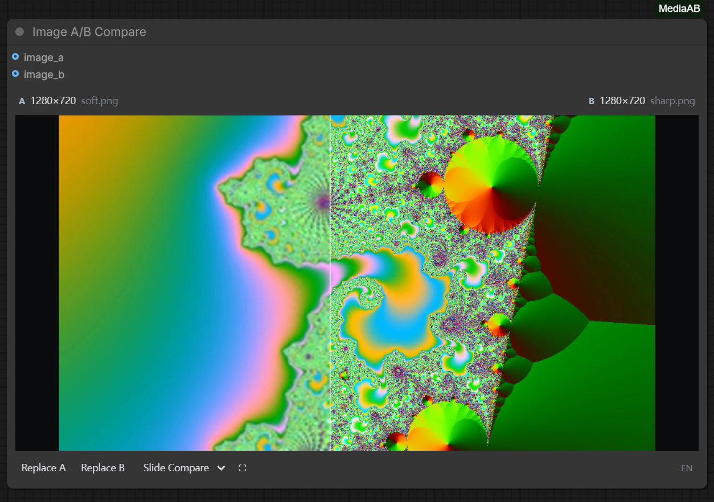
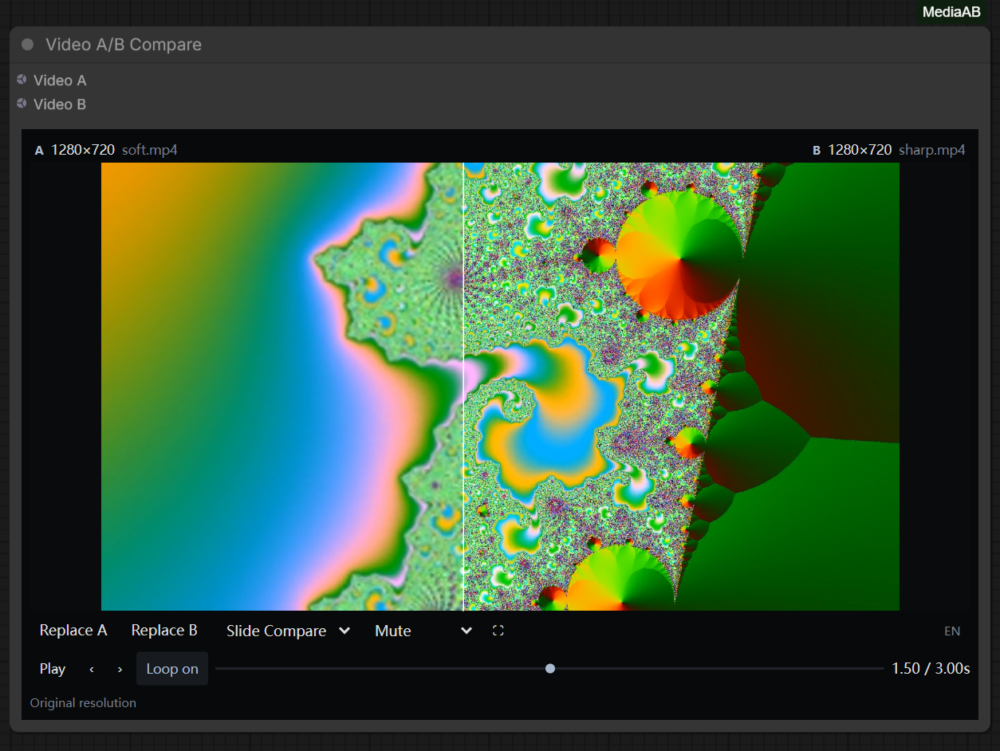

<h1 align="center">ComfyUI_MediaAB</h1>

<p align="center">
  Compare two images or two videos right inside ComfyUI.<br>
  Slide a divider across the picture, view them side by side, or flip between them.
</p>

<p align="center">
  English &nbsp;|&nbsp; <a href="README.zh-CN.md">简体中文</a>
</p>



When you upscale, denoise, restore or re-encode something, the question is always the same. Did it actually get better? MediaAB gives you two nodes that answer it quickly. Drop in the original and the result, move your mouse across the picture, and look at the details.

## What you get

There are two nodes. You can find them under **Add Node → MediaAB**.

| Node | What it does |
| --- | --- |
| **Image A/B Compare** | Compares two images. Connect two `IMAGE` outputs, or just pick and drop files onto the node. |
| **Video A/B Compare** | Compares two videos with synchronized playback and frame stepping. Accepts `VIDEO`, VHS Filenames, a path string, or files you drop in. |



### Features

- **Three ways to look.** Slide Compare moves the divider with your mouse, with no clicking or dragging needed. Side by side shows both at once. A/B Toggle flips between them.
- **A thin divider that stays thin.** When you zoom the ComfyUI canvas way in to check pixels, the divider line stays 1 pixel wide, so it never covers the detail you are trying to see.
- **Resolution and file name on both sides.** A sits on the top left and B on the top right, so you can spot a size mismatch right away. Long names are shortened and show in full when you hover.
- **Drop files anywhere on the node.** The first file fills A and the next fills B. Once both are filled, dropping on the left half replaces A and the right half replaces B. You can also drop onto the Select or Replace buttons to pick a side yourself.
- **Works with the ComfyUI asset panel.** Drag a generated or imported image or video straight from the panel. The node keeps a reference to the original file and saves it with your workflow.
- **No extra copies.** Files you pick or drop from your computer are read directly by the browser. Nothing is uploaded and nothing is written to your `input` folder.
- **Synchronized video playback.** Play, pause, loop, scrub the timeline, step frame by frame, and listen to the audio of A or B. Small drifts are corrected by nudging the playback speed, and larger ones by seeking.
- **Smooth scrubbing on big videos.** While you drag the timeline, MediaAB shows a full-resolution, all-keyframe cache so the picture follows your hand. When you let go it jumps back to the original file for the exact frame.
- **Keyboard friendly.** Click the picture to play or pause. With the picture focused, press Space to play or pause and the left and right arrow keys to step one frame.
- **Plays nicely with the canvas.** The mouse wheel still zooms the graph and the middle button still pans it while your cursor is over a node.
- **English and Chinese.** The panel follows your ComfyUI language setting. Every node also has an **EN / 中** button, and the choice is saved with the workflow.

## Install

You need a recent ComfyUI with the native `VIDEO` type and a recent ComfyUI frontend.

```bash
cd ComfyUI/custom_nodes
git clone https://github.com/xiaoshi-1990/ComfyUI_MediaAB.git
```

From `ComfyUI/custom_nodes`, run `python -m pip install -r ComfyUI_MediaAB/requirements.txt` with the Python environment you use for ComfyUI. For the Windows portable build, run the following command from the folder containing `python_embeded`.

```bat
python_embeded\python.exe -m pip install -r ComfyUI\custom_nodes\ComfyUI_MediaAB\requirements.txt
```

Restart ComfyUI and refresh the page. If the new nodes do not show up, force refresh the browser with `Ctrl + F5`.

An example workflow is included at `workflows/MediaAB_Example.json`. Drag it into ComfyUI to see both nodes ready to use.

## How to use it

### Image A/B Compare

1. Add the node, then click **Select A** and **Select B**, or drop two images onto it.
2. Or connect two `IMAGE` outputs to `image_a` and `image_b`. If you connect a **Load Image** node, the preview appears right away. Other nodes show up after you run the workflow.
3. Pick a view from the drop-down and move your mouse over the picture.

If an `IMAGE` input is a batch, the first image of the batch is shown.

### Video A/B Compare

1. Add the node, then click **Select A** and **Select B**, or drop two videos onto it.
2. Or connect something to `video_a` and `video_b`. These inputs accept all of the following.
   - A native `VIDEO`, such as the output of Load Video, Create Video or Save Video.
   - The `Filenames` output of Video Combine from VideoHelperSuite.
   - A text string holding a file path.
3. Press play, or move the mouse over the picture to slide the divider.

Paths can be absolute, or start with `input/`, `output/` or `temp/`. A Primitive String node holding a path and a Load Video node preview immediately. Anything that only exists after a node runs, such as the result of Create Video, appears once you run the workflow.

Both nodes have no outputs. They are for looking, and they will not hold up the rest of your workflow.

## Good to know

- **Local files are not saved with the workflow.** A file picked from your computer is shown only in the current page. After a refresh or a reopen, pick it again. Files that come from the ComfyUI asset panel are saved by reference, so keep the original files in place.
- **Videos are played by your browser.** If a video does not play, the codec is probably not supported by your browser. H.264 MP4 works almost everywhere.
- **Different lengths and frame rates.** Playback follows the shorter clip and matches the two timelines by seconds. Frame stepping uses the first available side (A, then B). For local files, the step buttons are available when MediaAB can read a constant frame rate from the file. Other clips can still be inspected by pausing and scrubbing. If you trimmed or skipped frames upstream, use the matching original segment.
- **The scrub cache.** For files that live in ComfyUI folders, MediaAB prepares a scrub cache in `temp/media_ab_hd` using the bundled `imageio-ffmpeg` on the CPU. Each cache file is limited to 1 GB and the folder is kept to about 2 GB, with the least recently used files removed first. Files you pick from your computer play and scrub straight from the original and do not use the cache.
- **Paths outside ComfyUI.** A video from outside the `input`, `output` and `temp` folders is copied to `temp/video_ab` so the browser can reach it.
- **Image previews of connected nodes** are written as PNG files to `temp/image_ab`.

## For developers

```bash
python tests/test_video_ab.py
node --experimental-vm-modules --test tests/test_canvas_interactions.mjs tests/test_local_video_timing.mjs
node tests/test_image_ab.cjs
node tests/test_video_import.cjs
```

The two `.cjs` tests run in Chrome using [Playwright](https://playwright.dev/).

## License

[MIT](LICENSE)
