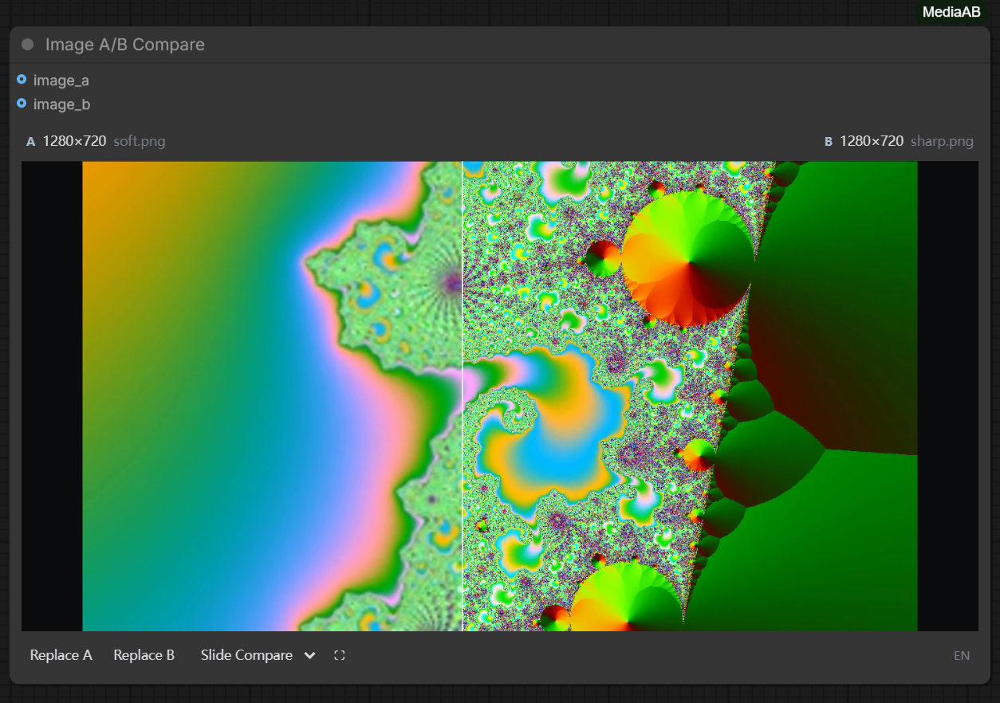
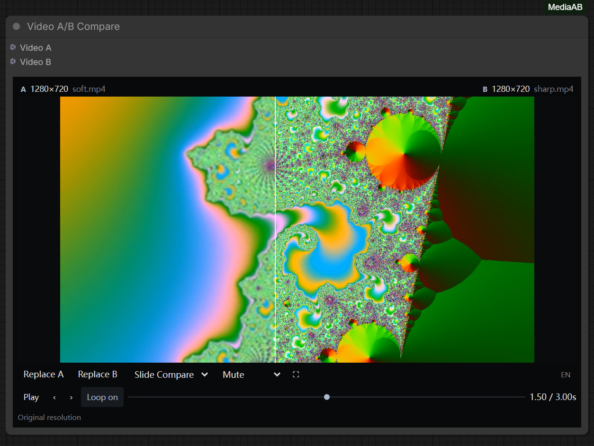

<h1 align="center">ComfyUI_MediaAB</h1>

<p align="center">
  在 ComfyUI 里直接对比两张图片或两段视频。<br>
  可以滑动分界线、左右并排，或来回切换。
</p>

<p align="center">
  <a href="README.md">English</a> &nbsp;|&nbsp; 简体中文
</p>



放大、降噪、修复或者重新编码之后，大家最想知道的永远是同一件事，效果到底有没有变好。MediaAB 提供两个节点，让你很快得到答案。把原图和结果放进去，在画面上移动鼠标，细节差别一眼就能看出来。

## 有什么

一共两个节点，在 **添加节点 → MediaAB** 里可以找到。

| 节点 | 作用 |
| --- | --- |
| **图片 A/B 对比** | 对比两张图片。可以连接两路 `IMAGE`，也可以直接点选或拖入文件。 |
| **视频 A/B 对比** | 同步播放两段视频并逐帧对比。支持 `VIDEO`、VHS 文件名、文件路径字符串，也支持直接拖入文件。 |



### 特色

- **三种查看方式。** 滑动对比只要移动鼠标就能改变分界线，不用按住也不用拖。并排显示可以同时看到两边。A/B 切换可以来回切换。
- **放大后依然很细的分界线。** 把 ComfyUI 画布放得很大去看像素时，分界线始终只有 1 个像素宽，不会盖住你想看的细节。
- **两侧都显示分辨率和文件名。** A 在左上角，B 在右上角，尺寸对不上时一眼就能发现。文件名太长会自动省略，鼠标停在上面可以看到完整名称。
- **拖到节点上任何位置都行。** 第一个文件会放进 A，下一个放进 B。两边都有素材后，拖到画面左半边替换 A，拖到右半边替换 B。想自己指定哪一侧，也可以直接拖到「选择」或「替换」按钮上。
- **支持 ComfyUI 资产面板。** 可以直接从面板里拖入已生成或已导入的图片和视频。节点会记住原文件的位置，并随工作流一起保存。
- **不产生多余的副本。** 从电脑里选择或拖入的文件由浏览器直接读取。不会上传，也不会往你的 `input` 文件夹里写东西。
- **视频同步播放。** 支持播放、暂停、循环、拖动时间轴、逐帧查看，还可以单独听 A 或 B 的声音。播放有小偏差时会微调速度追上，偏差大时才会跳转。
- **大视频也能顺畅拖动。** 拖动时间轴时，MediaAB 会显示原尺寸的全关键帧缓存，画面可以跟着手走。松手后会回到原始文件，显示精确的那一帧。
- **键盘也好用。** 点击画面可以播放或暂停。画面获得焦点后，按空格播放或暂停，按左右方向键逐帧查看。
- **不影响画布操作。** 鼠标停在节点上时，滚轮依然缩放画布，中键依然平移画布。
- **中英双语。** 面板会跟随 ComfyUI 的语言设置。每个节点上还有一个 **EN / 中** 按钮，选择会随工作流保存。

## 安装

需要较新的 ComfyUI（带有原生 `VIDEO` 类型）和较新的 ComfyUI 前端。

```bash
cd ComfyUI/custom_nodes
git clone https://github.com/xiaoshi-1990/ComfyUI_MediaAB.git
```

在 `ComfyUI/custom_nodes` 目录下，用运行 ComfyUI 的 Python 执行 `python -m pip install -r ComfyUI_MediaAB/requirements.txt`。如果用的是 Windows 便携版，请在包含 `python_embeded` 的便携版根目录运行下面的命令。

```bat
python_embeded\python.exe -m pip install -r ComfyUI\custom_nodes\ComfyUI_MediaAB\requirements.txt
```

重启 ComfyUI 并刷新页面。如果没有看到新节点，请按 `Ctrl + F5` 强制刷新浏览器。

仓库里附带了一个示例工作流 `workflows/MediaAB_Example.json`，拖进 ComfyUI 就能看到两个节点。

## 怎么用

### 图片 A/B 对比

1. 添加节点后，点击 **选择 A** 和 **选择 B**，或者直接把两张图片拖上去。
2. 也可以把两路 `IMAGE` 连到 `image_a` 和 `image_b`。如果连的是 **加载图像** 节点，预览会马上出现，其他节点需要运行工作流后才会显示。
3. 在下拉菜单里选一种查看方式，然后在画面上移动鼠标。

如果输入的是一批图片，只会显示这一批里的第一张。

### 视频 A/B 对比

1. 添加节点后，点击 **选择 A** 和 **选择 B**，或者直接把两段视频拖上去。
2. 也可以连接到 `video_a` 和 `video_b`。这两个输入可以接下面任何一种。
   - 原生 `VIDEO`，比如加载视频、创建视频、保存视频的输出。
   - VideoHelperSuite 里 Video Combine 的 `Filenames` 输出。
   - 保存着文件路径的文本字符串。
3. 点击播放，或者在画面上移动鼠标来滑动分界线。

路径可以是完整路径，也可以以 `input/`、`output/`、`temp/` 开头。保存着路径的 Primitive String 节点和加载视频节点会立即预览。创建视频这类要运行后才有结果的节点，需要先运行工作流才会显示。

两个节点都没有输出，只负责查看，不会影响工作流的其他部分。

## 需要了解的几点

- **从电脑里选的文件不会随工作流保存。** 这类文件只在当前页面显示，刷新或重新打开工作流后需要重新选择。从 ComfyUI 资产面板拖入的文件会以引用的方式保存，所以原文件请保留在原来的位置。
- **视频由浏览器负责播放。** 如果某段视频播放不了，多半是浏览器不支持它的编码。H.264 的 MP4 几乎在所有浏览器里都能播放。
- **长度和帧率不同的视频。** 两段视频按秒同步，播放长度以较短的一段为准。逐帧使用 A 的帧率，单放 B 时使用 B 的帧率。对于本地视频，能从文件中确认固定帧率时才启用逐帧按钮。其他素材可以暂停或拖动时间轴查看。如果上游有裁剪或跳帧，请选用对应的原始片段。
- **拖动缓存。** 对于位于 ComfyUI 文件夹里的文件，MediaAB 会用自带的 `imageio-ffmpeg` 在 CPU 上生成拖动缓存，放在 `temp/media_ab_hd`。单个缓存文件最大 1 GB，整个文件夹保持在 2 GB 左右，超出时会先清理最久没用的文件。从电脑里选择的文件直接用原始文件播放和拖动，不使用缓存。
- **ComfyUI 之外的路径。** 位于 `input`、`output`、`temp` 之外的视频，会复制一份到 `temp/video_ab`，浏览器才能访问到。
- **图片节点连线后的预览图** 会以 PNG 保存在 `temp/image_ab`。

## 开发

```bash
python tests/test_video_ab.py
node --experimental-vm-modules --test tests/test_canvas_interactions.mjs tests/test_local_video_timing.mjs
node tests/test_image_ab.cjs
node tests/test_video_import.cjs
```

两个 `.cjs` 测试通过 [Playwright](https://playwright.dev/) 在 Chrome 中运行。

## 许可证

[MIT](LICENSE)
